<div align="center">

# Guitar Practice Cloud

### Votre bibliothèque audio pour travailler la guitare

**Projet réalisé par Salima Mazaev · Groupe de TD 2**

Application Angular connectée à une API Express et MongoDB pour gérer un compte,
importer des pistes audio, les retrouver et les écouter.

</div>

---

## Le projet en un coup d'œil

Guitar Practice Cloud est un espace personnel de backing tracks. Le projet met
en pratique les trois travaux dirigés : authentification et profil (TP1),
bibliothèque audio (TP2), puis fiabilisation, suppression et progression
d'upload (TP3).

> **Pour la correction :** les captures des parcours et des requêtes sont
> intégrées ci-dessous. Les comptes rendus détaillés, résultats de tests et
> limites de vérification sont disponibles dans [`preuves/`](./preuves/).

### Parcours fonctionnels présentés

| TP | Fonctionnalités réalisées | Preuves dans ce README |
|---|---|---|
| **TP1 — Compte et profil** | Inscription, connexion/déconnexion, gestion des erreurs, profil connecté et modification du nom. | Réussite et refus de connexion, profil et requête de mise à jour. |
| **TP2 — Bibliothèque audio** | Pagination côté serveur, import multipart, validation des fichiers, lecture authentifiée et interface responsive. | Cards, requêtes de pagination, lecture, erreurs et affichage mobile. |
| **TP3 — Fiabilisation** | Suppression avec confirmation et retour utilisateur, progression d'upload et tests automatisés indépendants de MongoDB. | Requêtes DELETE/GET, progression et bilans de tests. |

## Démonstration et captures d'écran

Les images ci-dessous sont les captures conservées dans le dépôt. Les captures
Network illustrent les échanges HTTP observés dans le navigateur ; les
comptes rendus de vérification précisent le contexte, les statuts et les
éventuelles limites de chaque preuve. Les parcours API ont été testés avec le
backend local ; la configuration Atlas n'a pas été certifiée indépendamment
(voir le rapport TP1).

### TP1 — Authentification et profil

**Connexion acceptée et connexion refusée** — la seconde capture montre
l'erreur d'authentification sans exposer de mot de passe.

| Connexion réussie | Connexion refusée |
|---|---|
| 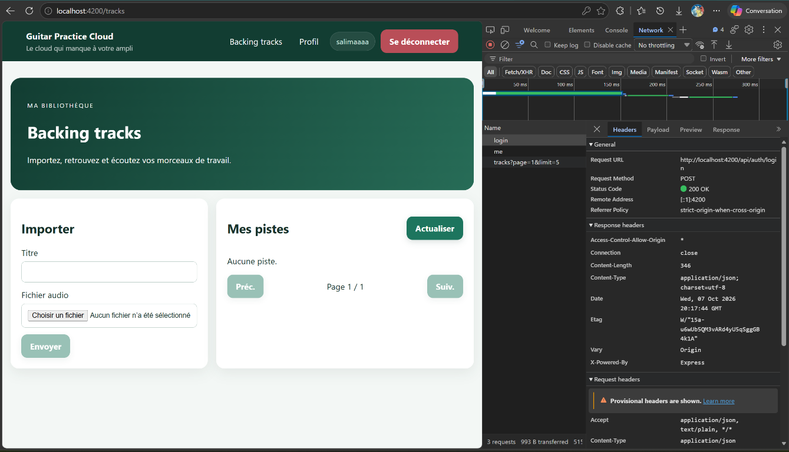 | 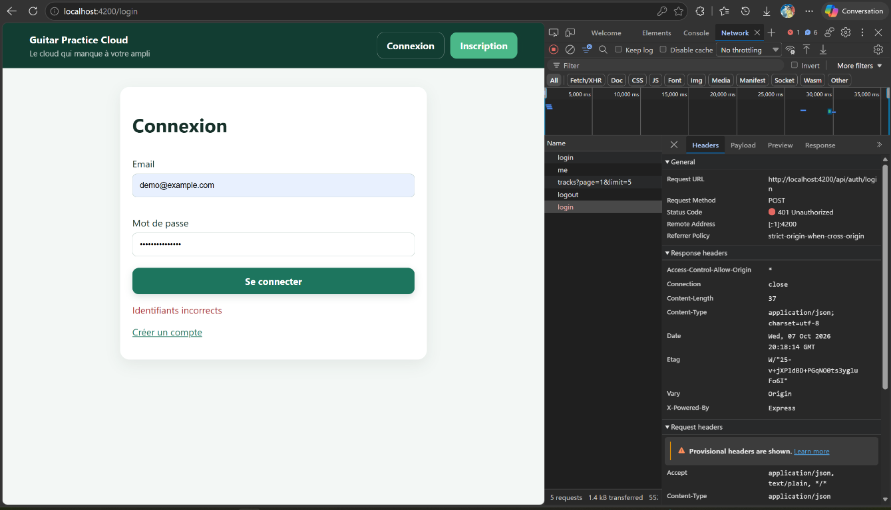 |

**Profil réactif et modification du nom** — l'interface affiche le nom
enregistré ; la capture Network montre la requête `PUT /api/users/me`.

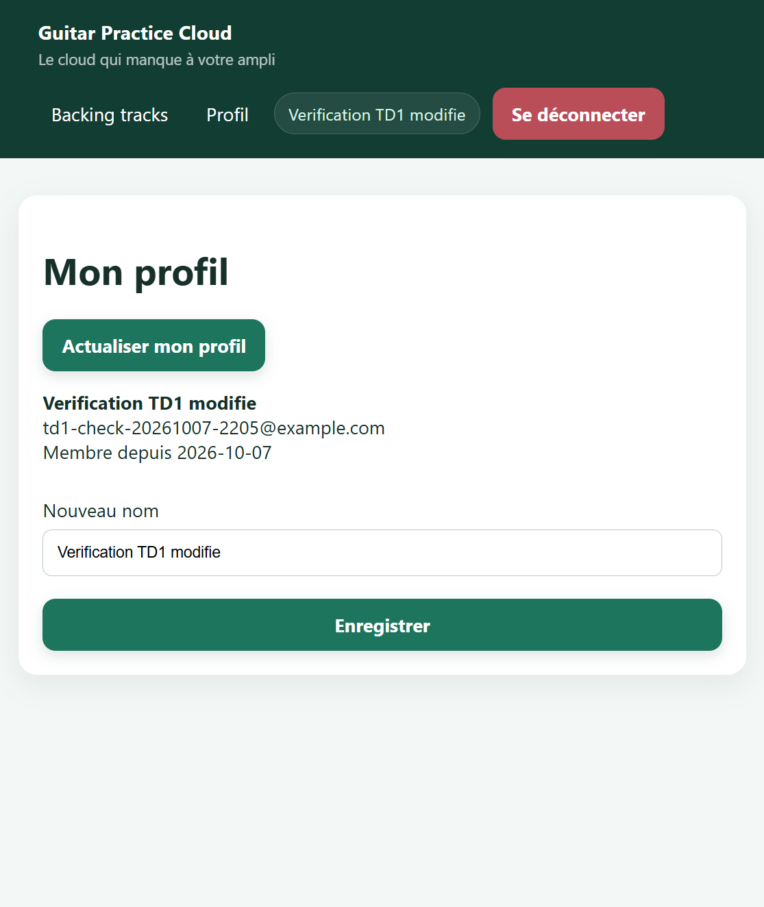

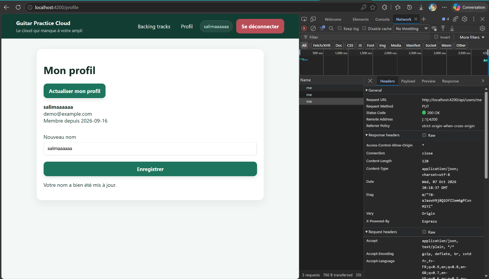

Les autres étapes vérifiées — inscription (`201`), déconnexion (`204`) et
traitement d'un jeton invalide (`401`) — sont consignées dans
[le rapport de vérification TP1](./preuves/tp1/verification.md).

### TP2 — Bibliothèque, upload et lecture audio

**Bibliothèque paginée** — les pistes sont présentées sous forme de cards avec
leurs informations et une action de lecture.

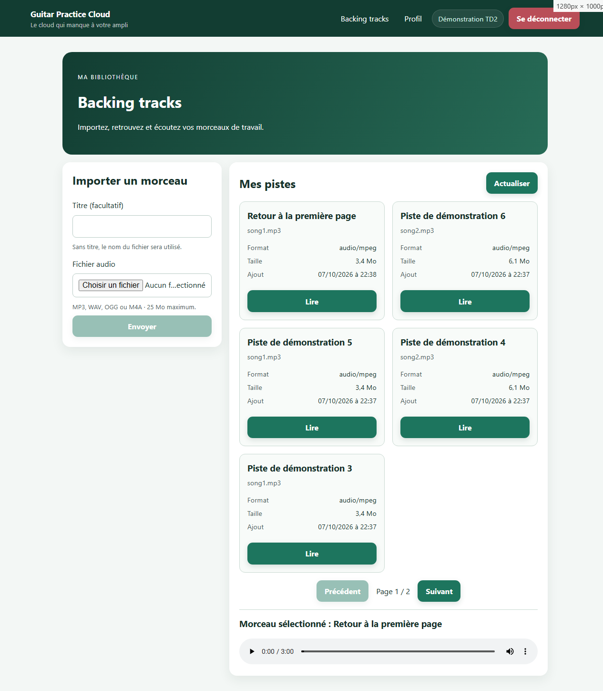

**Pagination serveur** — les paramètres `page` et `limit` changent lors du
passage d'une page à l'autre ; les preuves détaillées consignent les statuts
observés.

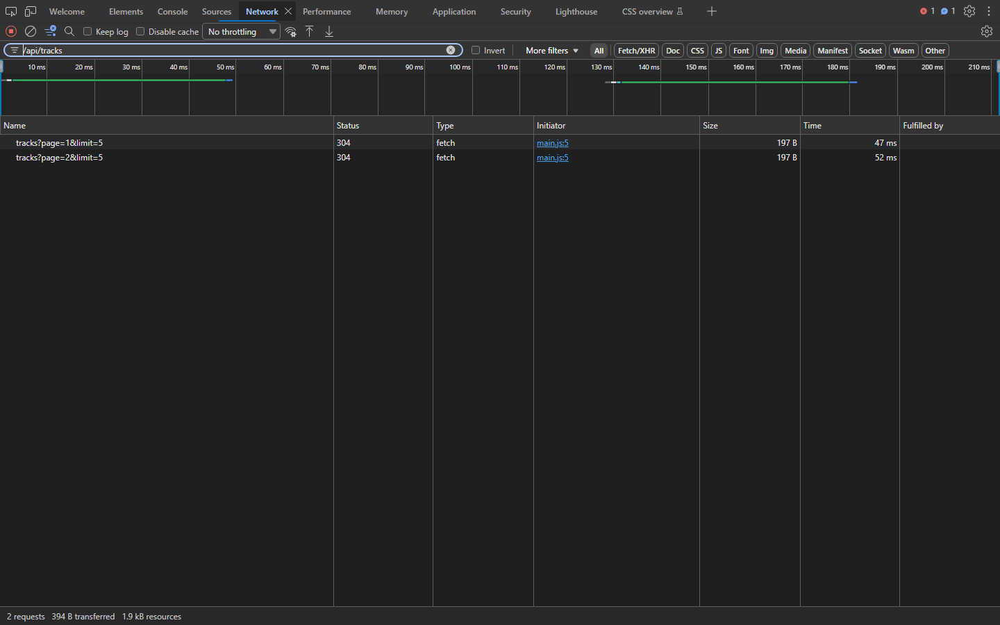

**Lecture authentifiée** — le lecteur affiche le morceau sélectionné. Le
téléchargement audio protégé et son autorisation sont documentés séparément
dans le compte rendu TP2.


**Validation des fichiers et erreurs** — les formats non acceptés sont
signalés avant l'envoi ; la réponse serveur `400` dispose également d'une
preuve dédiée.

| Validation dans l'interface | Réponse `400` de l'API |
|---|---|
| 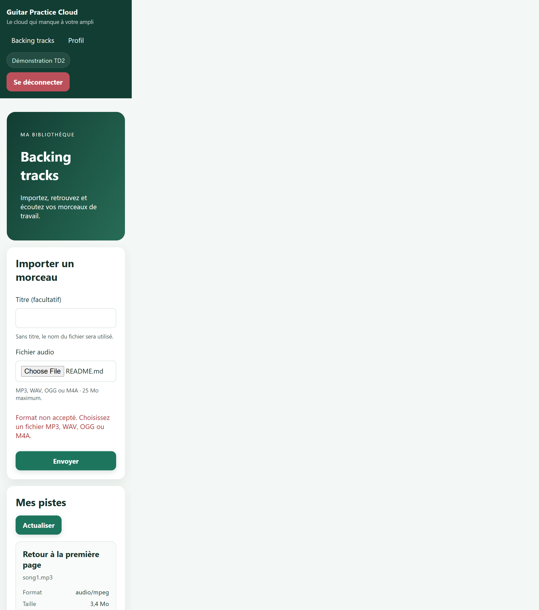 | 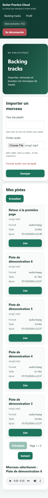 |

**Responsive** — capture de la bibliothèque à une largeur mobile de 390 px.

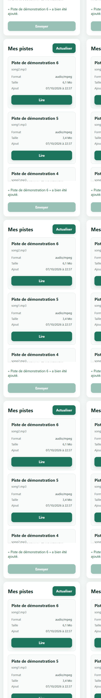

### TP3 — Suppression et progression

**Suppression** — la première capture montre `DELETE` accepté (`204`), la
seconde la requête de rechargement de la bibliothèque.

| Suppression de piste | Rechargement de la bibliothèque |
|---|---|
| 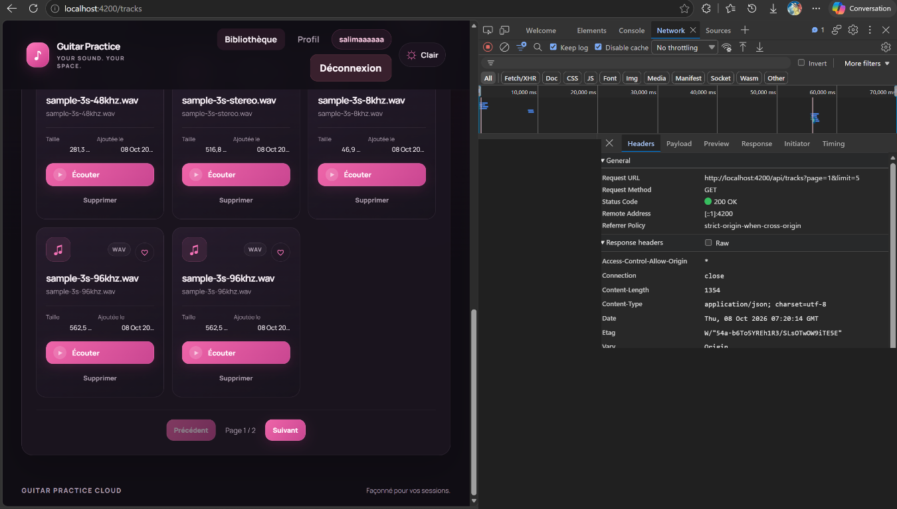 | 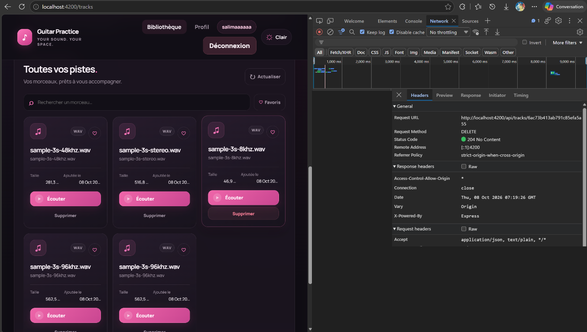 |

**Upload avec progression** — la capture associe l'envoi du fichier à la
progression visible dans l'interface.

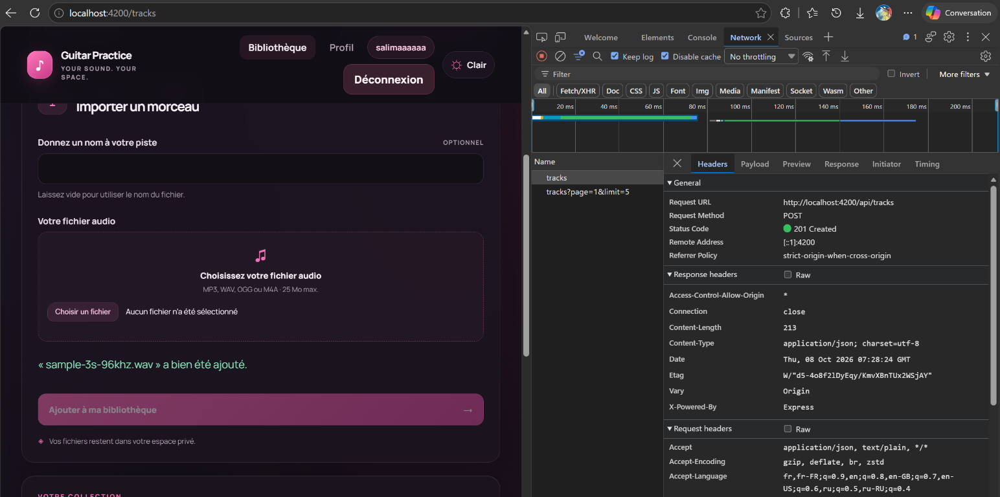

> **Précision sur la preuve de suppression :** la capture confirme la réponse
> `204` et un rechargement `GET`. Le rapport TP3 indique que ces images ne
> suffisent pas, à elles seules, à prouver visuellement que la piste concernée
> a disparu de la liste ; cette réserve est conservée dans
> [`preuves/tp3/verification.md`](./preuves/tp3/verification.md).

## Grille de conformité aux TP

| Consigne évaluée | Réalisation et vérification |
|---|---|
| **TP1 — Inscription, connexion, déconnexion et gestion des erreurs** | Parcours réussis et refusés observés ; voir [les preuves TP1](./preuves/tp1/verification.md). |
| **TP1 — Profil courant et modification du nom** | `GET`/`PUT /api/users/me`, session conservée après rechargement ; interface et Network ci-dessus. |
| **TP2 — Pagination réellement demandée à l'API** | `page` et `limit` transmis à chaque navigation ; aucune pagination locale de la liste complète. |
| **TP2 — Upload sécurisé et lisible** | Multipart avec `audio` et `title`, contrôles de format/taille, erreurs et succès documentés. |
| **TP2 — Lecture audio authentifiée** | Lecture via `Blob`/`ObjectURL`, avec contrôle du JWT et des réponses serveur. |
| **TP2 — Cards et adaptabilité mobile** | Métadonnées des pistes, commandes de lecture et vérification à 390 px. |
| **TP3 — Suppression et rafraîchissement** | Requête `DELETE` acceptée et `GET` de rafraîchissement capturés ; réserve de preuve visuelle indiquée ci-dessus et dans le rapport. |
| **TP3 — Progression d'upload** | Événements HTTP, pourcentage visible, prévention du double envoi et états d'erreur/réussite vérifiés. |
| **TP3 — Tests et build** | Résultats reproductibles listés dans la section [Vérifications](#vérifications). |

## Architecture

```text
Interface Angular
      │
      ▼
Services Angular ── HttpClient / intercepteur JWT
      │
      ▼
API Express ── Mongoose ── MongoDB
      │
      └── stockage et livraison des fichiers audio
```

Le frontend ne se connecte jamais directement à MongoDB. Les appels API et
leur authentification sont centralisés dans les services Angular ; les détails
des routes sont décrits dans [`API_CONTRACT.md`](./API_CONTRACT.md).

| Partie | Technologies |
|---|---|
| Frontend | Angular standalone, TypeScript, Signals, Reactive Forms, `HttpClient` |
| Backend | Node.js, Express, Mongoose, JWT, Multer |
| Données et fichiers | MongoDB Atlas et stockage audio géré par le backend |

## Lancer le projet

### Prérequis

- Node.js 22 ou plus récent et npm ;
- Git ;
- un compte MongoDB Atlas configuré selon [`ATLAS_SETUP.md`](./ATLAS_SETUP.md).

### 1. Configurer et démarrer l'API

Dans PowerShell :

```powershell
cd backend
Copy-Item .env.example .env
```

Renseigner localement `MONGODB_URI` et `JWT_SECRET` dans `backend/.env`, puis :

```powershell
npm install
npm start
```

L'API écoute par défaut sur `http://localhost:3000`. Ne jamais publier le
fichier `.env`, l'URI MongoDB ou le secret JWT.

### 2. Démarrer Angular

Dans un second terminal :

```powershell
cd frontend-starter
npm install
npm start
```

Ouvrir `http://localhost:4200`. Le proxy du frontend transmet les appels `/api`
au backend local. Le compte de démonstration créé par le backend est
`demo@example.com` / `Demo1234!`.

## Vérifications

Les résultats consignés après exécution sont :

| Vérification | Résultat consigné |
|---|---|
| `npm test` dans `frontend-starter/` | **20 tests réussis** dans 2 fichiers. |
| `npm run build` dans `frontend-starter/` | **Build réussi**. |
| `npm test` dans `backend/` | **5 tests réussis**. |

Pour les relancer :

```powershell
cd frontend-starter
npm test
npm run build
```

Dans un autre terminal :

```powershell
cd backend
npm test
```

Les tests frontend utilisent des réponses HTTP simulées et ne nécessitent pas
un backend ou une base MongoDB actifs. Ils complètent les vérifications
manuelles décrites dans les rapports ; ils ne les remplacent pas.

## Documents et preuves détaillées

- [Sujet TP1](./SUJET_ETUDIANT_TP1.md) · [Sujet TP2](./SUJET_ETUDIANT_TP2.md) · [Sujet TP3](./SUJET_ETUDIANT_TP3.md)
- [Contrat de l'API](./API_CONTRACT.md) · [Configuration MongoDB Atlas](./ATLAS_SETUP.md)
- [Explications techniques du TP2](./TD2_EXPLICATIONS.md)
- [Rapport IA — modèle à compléter](./RAPPORT_IA_MODELE.md)
- [Vérifications et captures TP1](./preuves/tp1/verification.md)
- [Vérifications et captures TP2](./preuves/tp2/verification.md)
- [Vérifications et captures TP3](./preuves/tp3/verification.md)
- [Conseils d'utilisation d'un assistant IA](./CONSEILS_POUR_UTIISER_ASSISTANT_AI.md)

---

<div align="center">

**Salima Mazaev · Groupe de TD 2**

*Guitar Practice Cloud — importer, organiser et écouter ses backing tracks.*

</div>
